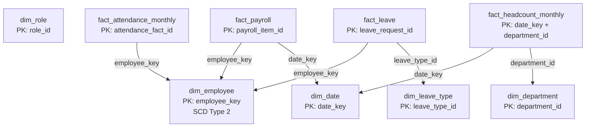


# PulseIQ Analytics — Task 2 Star Schema and Join Map

## 1. Join Map

The diagram shows only the seven fact-to-dimension foreign-key relationships declared in `schema.sql`.

## 2. Declared Fact-to-Dimension Joins

| Fact table | Dimension table | Join condition |
|---|---|---|
| `fact_payroll` | `dim_employee` | `FP.employee_key = DE.employee_key` |
| `fact_payroll` | `dim_date` | `FP.date_key = DT.date_key` |
| `fact_attendance_monthly` | `dim_employee` | `FA.employee_key = DE.employee_key` |
| `fact_leave` | `dim_employee` | `FL.employee_key = DE.employee_key` |
| `fact_leave` | `dim_leave_type` | `FL.leave_type_id = DLT.leave_type_id` |
| `fact_headcount_monthly` | `dim_date` | `FH.date_key = DT.date_key` |
| `fact_headcount_monthly` | `dim_department` | `FH.department_id = DD.department_id` |

## 3. Fact Table Grain

- `fact_payroll`: one source payroll item (`payroll_item_id`).
- `fact_attendance_monthly`: one employee's monthly attendance record (`attendance_fact_id`).
- `fact_leave`: one leave request (`leave_request_id`).
- `fact_headcount_monthly`: one department's headcount snapshot per date; composite primary key (`date_key`, `department_id`).

## 4. Employee History Rule — SCD Type 2

- `dim_employee.employee_key` identifies a specific employee-history version.
- `employee_id` may repeat across history versions.
- Join facts to `dim_employee` using `employee_key`, not `employee_id` alone.
- Use the historically correct employee version when the source supports that mapping. Do not guess unresolved mappings.

## 5. Unknown Employee Member

The schema inserts `employee_key = -1` into `dim_employee` for unknown or unresolved employees. Preserve source records referencing this key and document unresolved identities as source exceptions.

## 6. Relationships Not Declared as Foreign Keys

The schema contains these columns, but does not declare these foreign-key constraints:

- `dim_employee.department_id` → `dim_department.department_id`
- `dim_employee.role_id` → `dim_role.role_id`
- `dim_role.department_id` → `dim_department.department_id`

Do not present these as enforced foreign-key joins unless the schema is deliberately updated and the source relationships are validated.

## 7. Validation Notes

- Check orphan keys for every declared foreign-key relationship.
- Reconcile warehouse fact-table row counts against Task 1 accepted/clean source counts, accounting for documented exceptions.
- Record the actual SQL validation results before claiming validation has passed.
