# Task 19 — Step 3: Five-Metric Data Lineage

## Official requirement

Draw one lineage diagram for each metric showing:

**Raw table/source → ETL → warehouse table → metric view → dashboard**

## Scope

This document covers only the five selected metrics:
- `metric_m01_headcount`
- `metric_m03_exits`
- `metric_m09_payroll_cost`
- `metric_m16_revenue`
- `metric_m22_task_completion_rate`

## Verified implementation details

- Raw extracts use the project naming pattern: `data/raw/03_PulseIQ_Analytics_Star_Schema_Dataset.xlsx - <source_table>.csv`.
- `src/etl/etl_pipeline.py` reads raw extracts, validates/cleans them, writes clean CSVs to `data/clean`, and loads clean tables into PostgreSQL through its generic idempotent loader.
- Database inspection confirmed the five source fact tables and five metric views in the `public` schema.
- The metric-view SQL definitions are in `Task 4 - Governed Metric Layer/sql/metric_views_examples.sql`.
- `Task_5_First_Dashboard/pages/12_Metric_Explorer.py` contains the dashboard `METRICS` mappings for all five metrics.
- `src/warehouse/load_warehouse.py` is a separate curated loader into the `warehouse` schema. It is not the loader represented by these metric views: the verified views read `public.fact_*` tables. The diagrams therefore show the actual `public.fact_*` tables rather than incorrectly substituting `warehouse.fact_*`.

## Five metric lineage diagrams

### M01 — Headcount

- Raw source: `data/raw/03_PulseIQ_Analytics_Star_Schema_Dataset.xlsx - fact_headcount_monthly.csv`
- ETL: `src/etl/etl_pipeline.py` → `data/clean/fact_headcount_monthly.csv` → generic PostgreSQL loader
- Warehouse table: `public.fact_headcount_monthly`
- Metric view: `public.metric_m01_headcount`
- Dashboard path: `cloud_data` CSV → `cloud_data_public` CSV → `cloud_data_parquet` Parquet → `Task_5_First_Dashboard/cloud_data.py` → `Task_5_First_Dashboard/pages/12_Metric_Explorer.py` — `METRICS["Headcount"]`

### M03 — Exits

- Raw source: `data/raw/03_PulseIQ_Analytics_Star_Schema_Dataset.xlsx - fact_headcount_monthly.csv`
- ETL: `src/etl/etl_pipeline.py` → `data/clean/fact_headcount_monthly.csv` → generic PostgreSQL loader
- Warehouse table: `public.fact_headcount_monthly`
- Metric view: `public.metric_m03_exits`
- Dashboard path: `cloud_data` CSV → `cloud_data_public` CSV → `cloud_data_parquet` Parquet → `Task_5_First_Dashboard/cloud_data.py` → `Task_5_First_Dashboard/pages/12_Metric_Explorer.py` — `METRICS["Exits"]`

### M09 — Employer Payroll Cost

- Raw source: `data/raw/03_PulseIQ_Analytics_Star_Schema_Dataset.xlsx - fact_payroll.csv`
- ETL: `src/etl/etl_pipeline.py` → `data/clean/fact_payroll.csv` → generic PostgreSQL loader
- Warehouse table: `public.fact_payroll`
- Metric view: `public.metric_m09_payroll_cost`
- Dashboard path: `cloud_data` CSV → `cloud_data_public` CSV → `cloud_data_parquet` Parquet → `Task_5_First_Dashboard/cloud_data.py` → `Task_5_First_Dashboard/pages/12_Metric_Explorer.py` — `METRICS["Employer Payroll Cost"]`

```mermaid
flowchart LR
 A["Raw source<br/>fact_payroll.csv"] --> B["ETL<br/>src/etl/etl_pipeline.py<br/>clean + load"]
 B --> C["Warehouse table<br/>public.fact_payroll"]
 C --> D["Metric view<br/>public.metric_m09_payroll_cost"]
 D --> X["CSV export: export_cloud_data.py"]
 X --> Y["Public CSV copy: prepare_public_data.py"]
 Y --> Z["Parquet conversion: convert_to_parquet.py"]
 Z --> W["Parquet loader: cloud_data.py"]
 W --> E["Dashboard: 12_Metric_Explorer.py - Employer Payroll Cost"]
```

### M16 — Revenue

- Raw source: `data/raw/03_PulseIQ_Analytics_Star_Schema_Dataset.xlsx - fact_ledger.csv`
- ETL: `src/etl/etl_pipeline.py` → `data/clean/fact_ledger.csv` → generic PostgreSQL loader
- Warehouse table: `public.fact_ledger`
- Metric view: `public.metric_m16_revenue`
- Dashboard path: `cloud_data` CSV → `cloud_data_public` CSV → `cloud_data_parquet` Parquet → `Task_5_First_Dashboard/cloud_data.py` → `Task_5_First_Dashboard/pages/12_Metric_Explorer.py` — `METRICS["Revenue"]`

```mermaid
flowchart LR
 A["Raw source<br/>fact_ledger.csv"] --> B["ETL<br/>src/etl/etl_pipeline.py<br/>clean + load"]
 B --> C["Warehouse table<br/>public.fact_ledger"]
 C --> D["Metric view<br/>public.metric_m16_revenue"]
 D --> X["CSV export: export_cloud_data.py"]
 X --> Y["Public CSV copy: prepare_public_data.py"]
 Y --> Z["Parquet conversion: convert_to_parquet.py"]
 Z --> W["Parquet loader: cloud_data.py"]
 W --> E["Dashboard: 12_Metric_Explorer.py - Revenue"]
```

### M22 — Task Completion Rate

- Raw source: `data/raw/03_PulseIQ_Analytics_Star_Schema_Dataset.xlsx - fact_task.csv`
- ETL: `src/etl/etl_pipeline.py` → `data/clean/fact_task.csv` → generic PostgreSQL loader
- Warehouse table: `public.fact_task`
- Metric view: `public.metric_m22_task_completion_rate`
- Dashboard path: `cloud_data` CSV → `cloud_data_public` CSV → `cloud_data_parquet` Parquet → `Task_5_First_Dashboard/cloud_data.py` → `Task_5_First_Dashboard/pages/12_Metric_Explorer.py` — `METRICS["Task Completion Rate"]`

```mermaid
flowchart LR
 A["Raw source<br/>fact_task.csv"] --> B["ETL<br/>src/etl/etl_pipeline.py<br/>clean + load"]
 B --> C["Warehouse table<br/>public.fact_task"]
 C --> D["Metric view<br/>public.metric_m22_task_completion_rate"]
 D --> X["CSV export: export_cloud_data.py"]
 X --> Y["Public CSV copy: prepare_public_data.py"]
 Y --> Z["Parquet conversion: convert_to_parquet.py"]
 Z --> W["Parquet loader: cloud_data.py"]
 W --> E["Dashboard: 12_Metric_Explorer.py - Task Completion Rate"]
```

## Dashboard export path for the five metrics

Each selected metric view is exported by `scripts/export_cloud_data.py` as a CSV in `cloud_data`. `scripts/prepare_public_data.py` copies the CSV into `cloud_data_public`. `scripts/convert_to_parquet.py` converts the public CSV into a Parquet file in `cloud_data_parquet`. `Task_5_First_Dashboard/cloud_data.py` loads the Parquet file, and `Task_5_First_Dashboard/pages/12_Metric_Explorer.py` maps and displays the metric. The five selected CSV and Parquet files were confirmed present in the project folders.

## Verification summary

| Metric | Source table | PostgreSQL table | Metric view | Dashboard mapping |
|---|---|---|---|---|
| M01 Headcount | `fact_headcount_monthly` | `public.fact_headcount_monthly` | `public.metric_m01_headcount` | `Headcount` |
| M03 Exits | `fact_headcount_monthly` | `public.fact_headcount_monthly` | `public.metric_m03_exits` | `Exits` |
| M09 Employer Payroll Cost | `fact_payroll` | `public.fact_payroll` | `public.metric_m09_payroll_cost` | `Employer Payroll Cost` |
| M16 Revenue | `fact_ledger` | `public.fact_ledger` | `public.metric_m16_revenue` | `Revenue` |
| M22 Task Completion Rate | `fact_task` | `public.fact_task` | `public.metric_m22_task_completion_rate` | `Task Completion Rate` |

**Schema clarification:** These five metric views were verified against `public.fact_*` source tables. The separate `warehouse.*` loader must not be substituted in these diagrams.

**Step 3 status:** The five selected metrics have documented lineage diagrams covering raw source, ETL, PostgreSQL table, metric view, CSV export, public CSV copy, Parquet conversion, dashboard loader, and dashboard consumer. The documented mappings reflect the inspected project scripts and SQL definitions.
