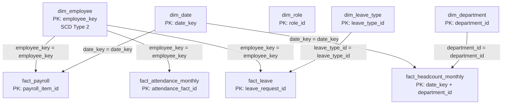

# PulseIQ Analytics — Task 2 Star Schema and Join Map

## 1. Join Map

## 2. Join Map Explanation

| Fact table | Dimension | Join condition |
|---|---|---|
| fact_payroll | dim_employee | `FP.employee_key = DE.employee_key` |
| fact_payroll | dim_date | `FP.date_key = DT.date_key` |
| fact_attendance_monthly | dim_employee | `FA.employee_key = DE.employee_key` |
| fact_leave | dim_employee | `FL.employee_key = DE.employee_key` |
| fact_leave | dim_leave_type | `FL.leave_type_id = DLT.leave_type_id` |
| fact_headcount_monthly | dim_date | `FH.date_key = DT.date_key` |
| fact_headcount_monthly | dim_department | `FH.department_id = DD.department_id` |

## 3. Employee History Rule

`employee_key` is the warehouse key for a specific employee history version. Use it to join facts to `dim_employee`; do not join historical facts to the employee dimension using `employee_id` alone.

## 4. Important Schema Note

`dim_employee.department_id` and `dim_employee.role_id` describe the employee dimension's department and role attributes. `dim_role.department_id` describes the role's department. These columns do not currently have declared foreign-key constraints in `schema.sql`, so the diagram does not represent them as enforced fact-to-dimension joins.

The current schema also does not declare an employee-to-department or employee-to-role foreign key. Add such constraints only after verifying the source data and the intended historical model.
